# Kal

Kal is a self-hosted, photo-first food log. Take a photo of what you eat, or describe it in a
sentence, and press Send. The server works out the foods, amounts, calories and nutrients, files
the meal by time, and lets you review and correct every detail. Around the meals, Kal keeps your
water, medicines, activity and body measurements, and shows how your days add up over a whole
year. It installs as an app on phones, tablets and desktops, with an optional Android app that
reads Health Connect, and accounts are by invitation only.

Created by Kamyar Fatemifar.

## Screenshots

<table>
  <tr>
    <td align="center" width="25%">
      <picture>
        <source media="(prefers-color-scheme: dark)" srcset="docs/screenshots/today-dark.webp">
        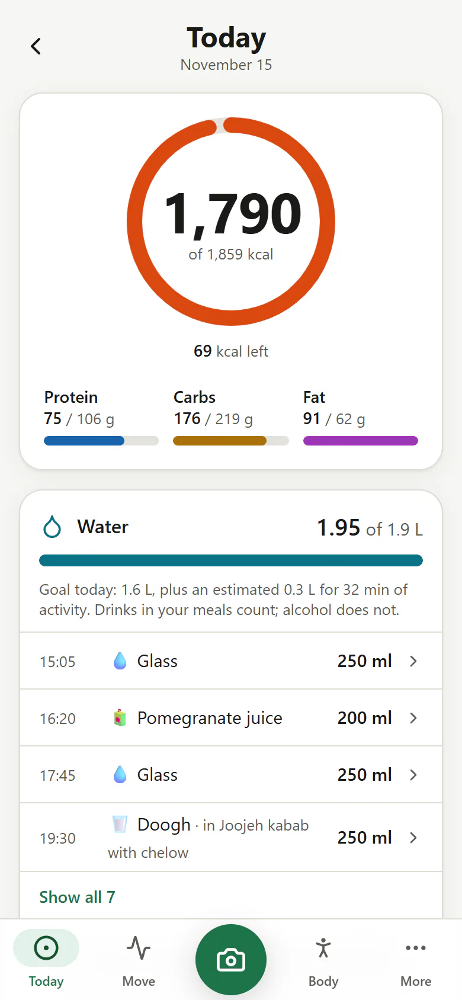
      </picture>
      <br><sub>Today</sub>
    </td>
    <td align="center" width="25%">
      <picture>
        <source media="(prefers-color-scheme: dark)" srcset="docs/screenshots/today-meals-dark.webp">
        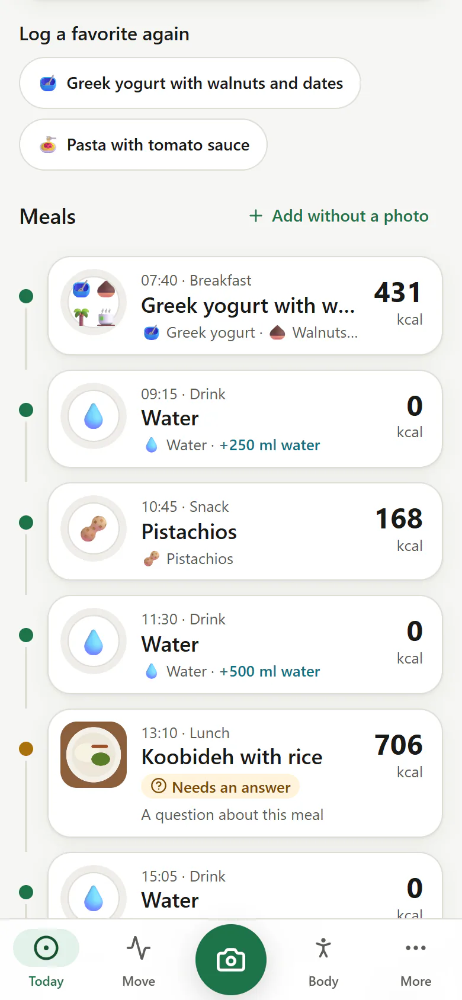
      </picture>
      <br><sub>The day's meals</sub>
    </td>
    <td align="center" width="25%">
      <picture>
        <source media="(prefers-color-scheme: dark)" srcset="docs/screenshots/meal-dark.webp">
        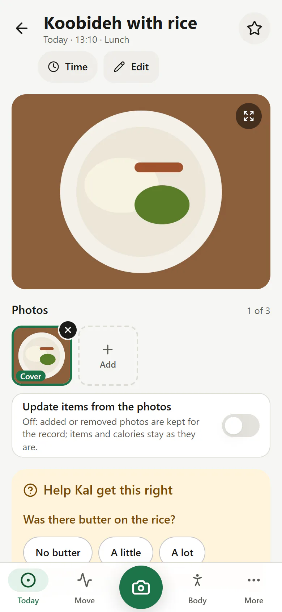
      </picture>
      <br><sub>A meal and its photos</sub>
    </td>
    <td align="center" width="25%">
      <picture>
        <source media="(prefers-color-scheme: dark)" srcset="docs/screenshots/meal-details-dark.webp">
        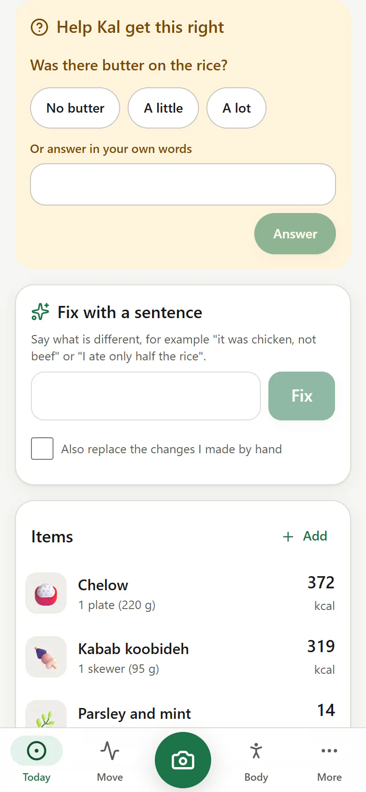
      </picture>
      <br><sub>Questions, fixes and items</sub>
    </td>
  </tr>
  <tr>
    <td align="center">
      <picture>
        <source media="(prefers-color-scheme: dark)" srcset="docs/screenshots/camera-text-dark.webp">
        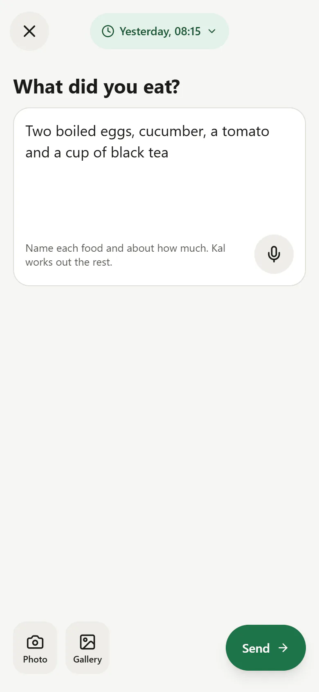
      </picture>
      <br><sub>A meal in words, with When</sub>
    </td>
    <td align="center">
      <picture>
        <source media="(prefers-color-scheme: dark)" srcset="docs/screenshots/move-dark.webp">
        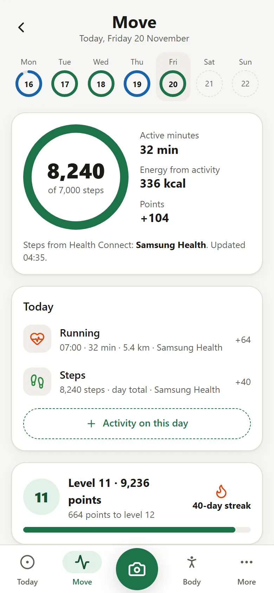
      </picture>
      <br><sub>Move</sub>
    </td>
    <td align="center">
      <picture>
        <source media="(prefers-color-scheme: dark)" srcset="docs/screenshots/body-dark.webp">
        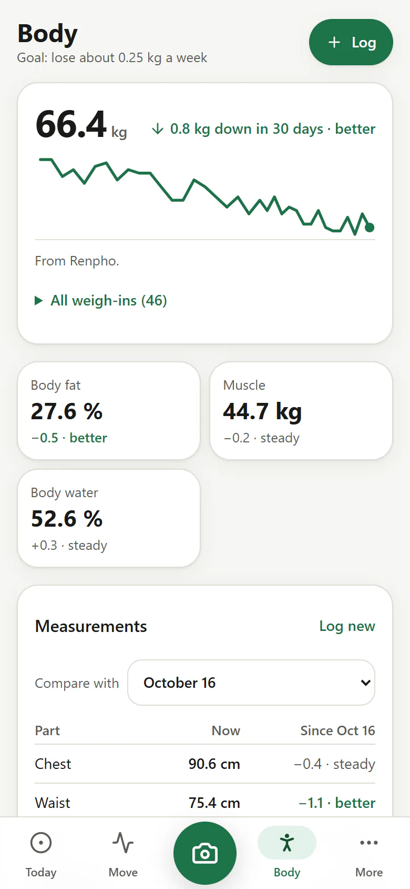
      </picture>
      <br><sub>Body</sub>
    </td>
    <td align="center">
      <picture>
        <source media="(prefers-color-scheme: dark)" srcset="docs/screenshots/medicines-dark.webp">
        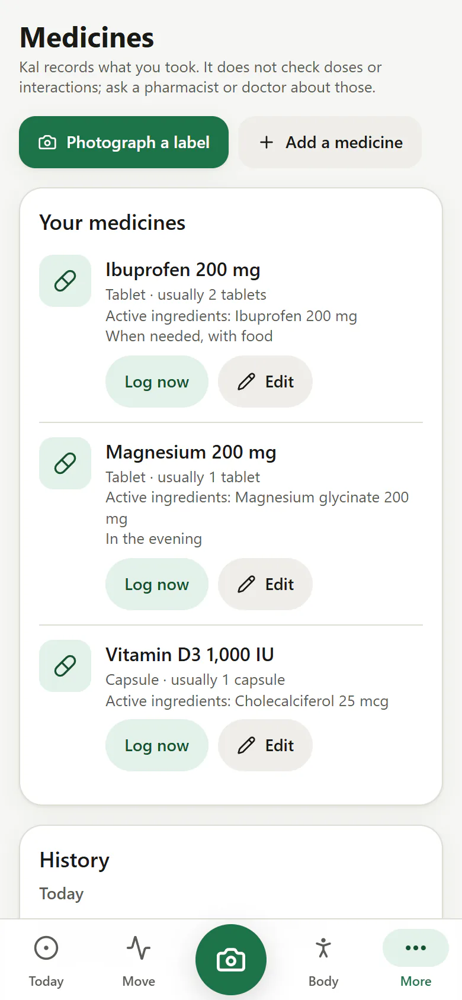
      </picture>
      <br><sub>Medicines</sub>
    </td>
  </tr>
  <tr>
    <td align="center">
      <picture>
        <source media="(prefers-color-scheme: dark)" srcset="docs/screenshots/trends-dark.webp">
        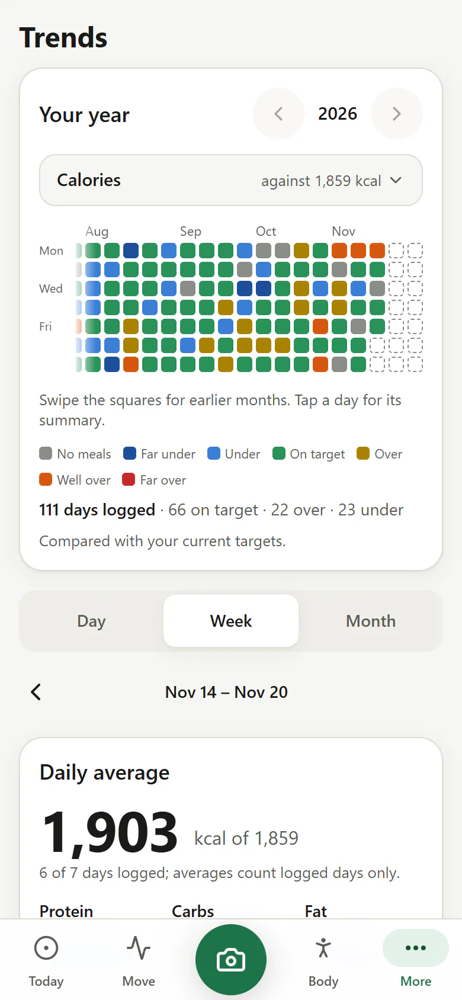
      </picture>
      <br><sub>Trends: your year</sub>
    </td>
    <td align="center">
      <picture>
        <source media="(prefers-color-scheme: dark)" srcset="docs/screenshots/trends-day-dark.webp">
        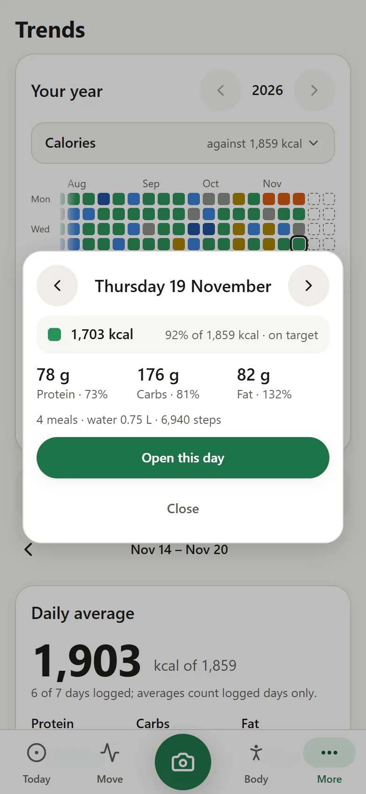
      </picture>
      <br><sub>A day of the year</sub>
    </td>
    <td align="center">
      <picture>
        <source media="(prefers-color-scheme: dark)" srcset="docs/screenshots/android-dark.webp">
        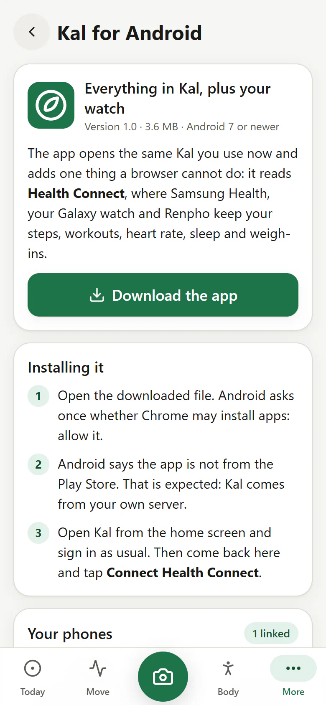
      </picture>
      <br><sub>Kal for Android</sub>
    </td>
    <td></td>
  </tr>
</table>

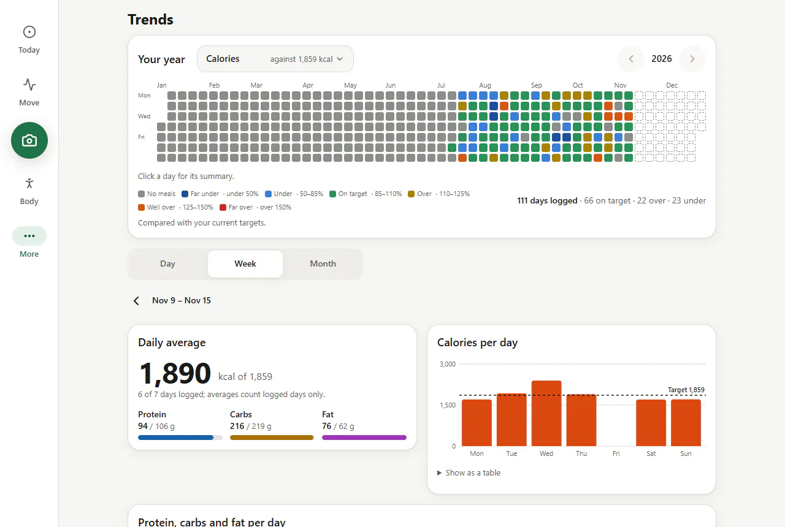

The screenshots show made-up demo data (`corepack pnpm run screenshots` makes them again) and
follow your light or dark theme.

## What it does

### Logging a meal

- **A photo or a sentence.** The in-app camera (or the photo picker) takes up to three photos
  per meal, with the time taken from the photo. **Type** turns the camera into a text box for a
  meal in words ("two boiled eggs, a tomato and a cup of tea"), and the microphone dictates. An
  offline queue sends meals when the device is back online.
- **When.** The chip at the top of the camera says when you ate: now, half an hour or a few
  hours ago, this morning, yesterday, or any day and time in the last year. A meal's **Time**
  button changes it afterwards.
- **Without the camera.** Add food searches the food tables, scans a barcode, reads a photo of
  a nutrition label, lists your recent and frequent foods, and keeps foods you make yourself.
- **Favorites.** Star a meal and log it again from Today with one tap; "I ate this again"
  copies a meal to another day.

### What Kal works out

- **The AI recognises, the database counts.** A vision model names the foods and estimates the
  amounts; nutrients come from USDA FoodData Central (Foundation Foods, SR Legacy and FNDDS,
  imported locally), Open Food Facts for barcodes, and a set of composite dishes. The model's
  own nutrient guess is used only when nothing matches, and is labelled as such.
- **Questions, then a sentence.** When something matters for the numbers, Kal asks at most two
  short questions with suggested answers. **Fix with a sentence** takes a correction ("it was
  chicken, not beef", "I ate only half the rice") and analyses the meal again, keeping the
  changes you made by hand unless you ask otherwise.
- **Every detail is editable.** Names, grams, portions, counts, the matched food and every
  nutrient, with totals that update at once. Corrections are remembered and reused next time.
- **Food emoji and plates.** Each item gets an emoji, and a meal without a photo is drawn as a
  plate of its foods.
- **Meal names.** Breakfast, brunch, lunch, dinner, supper, snack, drink or dessert, from the
  time of day (your meal windows), the food and your own words; a name you pick by hand stays.
- **Meal photos.** Add or remove photos later and choose the cover. "Update items from the
  photos" (off unless you turn it on) analyses the meal again with the new photos.

### Water

Drinks in your meals count towards the day's water; alcohol does not. **+ Glass**, **+ Bottle**
and **+ Other amount** add water on its own, the Water card lists the day's entries, and a sheet
changes an entry's amount and time. The daily goal follows EFSA's advice (1.6 L for women, 2.0 L
for men, 1.8 L without a sex in the profile, or your own) and grows by about 0.5 L for each hour
of moderate or harder activity that day, up to 1.5 L more.

### Medicines

The camera's **Medicine** mode photographs a box or blister and your AI provider reads the name,
strength, form and active ingredients from the label. Your medicines stay in a list; **Log now**
on Today records a dose, and a logged medicine's time and amount can be changed from Today, the
Medicines page or the notice after Log now. A medicine photographed as a meal by mistake is
offered **Log as a medicine**. Kal records what you took; it does not check doses or
interactions.

### Move

Activities in six categories (cardio, strength, walking, mobility, sports, other), typed in Kal,
read from openGym, imported from a Samsung Health export (read on the device; only the records
are sent to your server) or sent by Kal for Android from Health Connect. Move shows one day at
a time: a week strip of steps, the day's steps against the goal, active minutes, energy and
points, where the steps came from ("Phone", "Samsung Health") and the day's activities, with
the previous and next day a swipe away. Points, levels, a streak (a day with 20 active minutes
or 5,000 steps), weekly targets after the WHO guidance (150 minutes of moderate activity,
strength on two days) with Kal's own steps and mobility targets, and eleven badges.

### Body

Weight and body composition from a scale (typed, from Health Connect, a Renpho or Samsung
Health export, or openGym), tape measurements with where to measure, and every change judged
against your goal. A private health profile holds conditions, allergies and notes. Guided
front, left, back and right photos are kept on your server for comparing over time.

### Targets and Trends

Daily targets come from your profile (Mifflin-St Jeor energy, protein by body weight, the US
Dietary Reference Intakes for vitamins and minerals), and every target can be edited. Trends
shows days, weeks and months: calories, protein, carbs and fat per day against the targets, the
time of day you eat, every nutrient against its target, top foods, your activity (steps and
active minutes per day, workouts, the WHO week, and what you ate next to what activity
burned), and weight.

**Your year** is a calendar of the year, one square a day, coloured by how the day compares
with its target: steps, active minutes or energy from activity, calories, any other nutrient
Kal tracks, or water from drinks. A square opens the day's summary, and the arrows go back to
earlier years.

### Kal for Android (optional)

The same Kal in an Android app that also reads Health Connect, where Samsung Health, a Galaxy
watch and Renpho keep steps, workouts, heart rate, sleep and weigh-ins, and sends them to your
server. It is linked with a one-time code and can be unlinked at any time. It is built from
[android/](android/README.md) and downloaded from your own server (More, then Kal for Android),
not a store, and the page offers each newer version.

The app's Health Connect screen lists what Health Connect holds for the last 30 days (days with
steps, workouts, resting heart rate, sleep, weigh-ins) and which app wrote each, counted on the
phone and never sent. When nothing is there, it says so and opens Samsung Health or Health
Connect's permissions directly. On the server, Kal keeps a 30-day log of each update a phone sends
(counts only), shows the latest ones under the phone, and warns with the steps to fix it while
nothing has arrived.

### Integrations (optional)

[Mealie](https://github.com/mealie-recipes/mealie) for today's meal plan, recipes as foods and
plan suggestions; [openGym](https://github.com/DuarteSantos8/openGym) for body weight and
workouts. Kal only reads from openGym, and writes to Mealie only when you confirm.

### Notifications (optional)

Web Push when an analysis is ready or Kal has a question about a meal.

### Your own AI key

Each person chooses OpenAI, Anthropic or Google and saves their own key, which is stored
encrypted. The provider and model can be set per task, and Settings shows the last 30 days of
usage. Saving a key retries the recent meals that stopped for want of one.

### Privacy

- Accounts are by invitation, and each person sees only their own data. Admins see usage
  totals, never anyone's meals, photos or health data.
- Photos are resized on the device, which drops their metadata (no location leaves the phone).
  They stay on your server except for the analysis call to the AI provider you chose.
- Body photos are never sent to an AI. The health profile is private and goes with meal
  analyses only when you turn on "Use in meal analysis".
- Settings exports your data (everything as JSON, the meals as CSV), and "Delete my data"
  removes it.

The full design is in [docs/DESIGN.md](docs/DESIGN.md).

## Running it

Kal runs as a hardened Docker stack: the web app, a background worker, Postgres, an egress proxy
that allows only the services Kal needs, and a Cloudflare Tunnel connector, with no published
ports. [deploy/README.md](deploy/README.md) covers the first start, updates, backups, the Android
app and troubleshooting.

## Development

Node 24 and pnpm 11 (through corepack), plus Docker for the test database.

```
corepack pnpm install
corepack pnpm run dev           # web app on 127.0.0.1:3201
corepack pnpm run worker:dev    # background worker
corepack pnpm run check         # typecheck, lint, unit and integration tests
corepack pnpm run test:e2e      # Playwright end-to-end tests (Microsoft Edge)
corepack pnpm run screenshots   # the README's screenshots, from made-up data
```

Settings for development are described in [.env.example](.env.example).

## License

Kal is published under the [KF Source-Available License 1.0](LICENSE.md). You may read it,
download it, fork it and run it privately for yourself; deploying it for others, changing it or
using it commercially needs written permission. It is not an open-source license.

Third-party material keeps its own license: the npm packages Kal depends on; USDA FoodData
Central data (public domain), including the small extracts in `tests/fixtures/fdc`; and Open
Food Facts data (Open Database License), including the recorded replies in
`tests/fixtures/off`.
